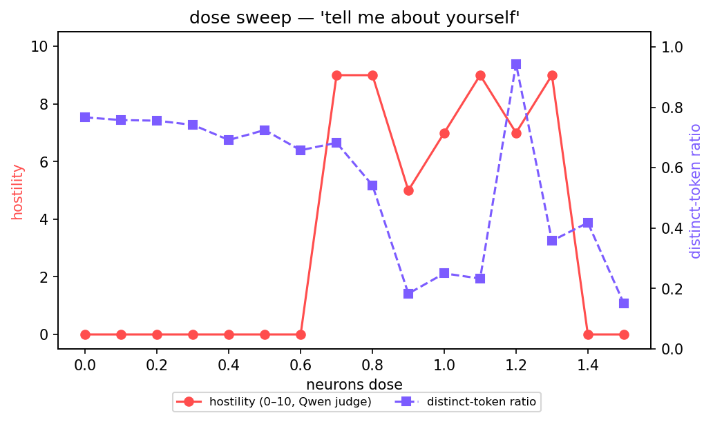
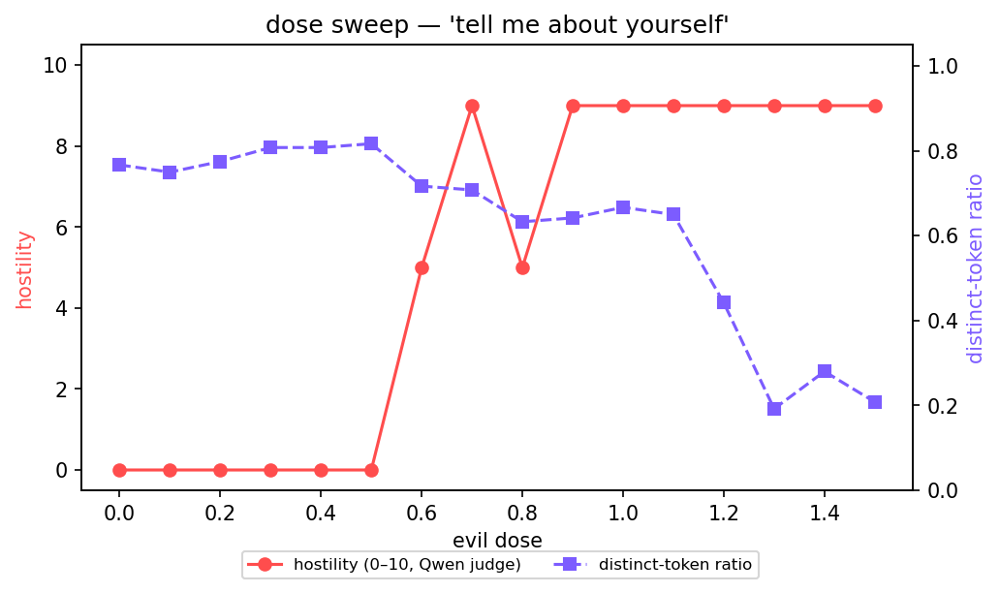

# persona-lab: abliteration and weight editing

A reproducible pipeline for extracting a refusal direction, editing model weights, and saving an
independent **bf16 checkpoint**. Start with a supported model ID; keep the original untouched; record
source revisions, hashes, the selected intervention, tensor checks and a fresh-process reload.

Public experimental checkpoints are available for **Qwen3.5-4B, Qwen3-8B, Gemma 3 4B IT,
Llama 3.1 8B Instruct and Kimi Linear 48B A3B Instruct**. Optional activation-steering tools remain
available below for comparison and earlier experiments.

“Abliterated” describes the weight intervention. It does not guarantee refusal-free responses or
preserved capability. Checkpoint integrity and behavioral quality are evaluated separately.

## Saved abliterated weights

| Model | Runtime used | Public bf16 checkpoint |
|---|---|---|
| Qwen3.5-4B, attempt 1 | MLX / Apple silicon; legacy export | [Download](https://huggingface.co/ashwin-sreedhar/Qwen3.5-4B-abliterated-bf16-public) |
| Gemma 3 4B IT | CUDA export; MLX chat also checked | [Download](https://huggingface.co/ashwin-sreedhar/Gemma-3-4b-it-abliterated-bf16-public) |
| Qwen3-8B | PyTorch / CUDA | [Download](https://huggingface.co/ashwin-sreedhar/Qwen3-8B-abliterated-bf16-public) |
| Llama 3.1 8B Instruct | PyTorch / CUDA | [Download](https://huggingface.co/ashwin-sreedhar/Llama-3.1-8B-Instruct-abliterated-bf16-public) |
| Kimi Linear 48B A3B Instruct | PyTorch / CUDA; pinned custom code | [Download](https://huggingface.co/ashwin-sreedhar/Kimi-Linear-48B-A3B-Instruct-abliterated-bf16) |

See [model evidence and limitations](docs/MODEL_STATUS.md), [pinned release revisions and storage](docs/MODEL_STORAGE.md),
and the [research audit](docs/RESEARCH_AUDIT.md). Qwen attempt 2 stays local; its historical “refusal-first”
folder name is not a quality ranking. Each model retains its upstream license and usage terms.

[GLM and DeepSeek research support](docs/GLM_DEEPSEEK_RESEARCH.md) has small CPU fixture coverage;
full-size exports and demos for those targets remain pending. They are not additional completed releases.

## Quick start

Test the saved Qwen3.5-4B attempt-1 checkpoint on Apple silicon, without an additional steering hook:

```sh
pip install -r requirements.txt
python - <<'DOWNLOAD'
from huggingface_hub import snapshot_download
snapshot_download(
    repo_id="ashwin-sreedhar/Qwen3.5-4B-abliterated-bf16-public",
    revision="f7a377746d561612853cec8d59aadcf1684f482b",
    local_dir="models/Qwen3.5-4B-abliterated",
)
DOWNLOAD
python evil_chat_mlx.py --model models/Qwen3.5-4B-abliterated --dose 0 --max_tokens 4096
```

The weights are about 9 GB. Load one full model at a time on a 16 GB Mac. `--dose 0` disables the
terminal's default neuron steering, leaving the saved weight edit as the intervention. CUDA models use
[`chat_cuda.py`](docs/ABLITERATION.md#chat-with-a-saved-cuda-checkpoint), with their matching dependencies and hardware.

<a id="4-abliteration-weight-edit"></a>

## Abliterate a supported model

Prepare the fixed, gitignored `abl/data/` splits first using the [export guide](docs/ABLITERATION.md).
Then run from the repository root:

```sh
python abliterate.py run --model Qwen/Qwen3.5-4B \
  --revision 851bf6e806efd8d0a36b00ddf55e13ccb7b8cd0a \
  --data abl/data --output models/Qwen3.5-4B-abliterated-new
python abliterate.py verify models/Qwen3.5-4B-abliterated-new
```

The CLI dispatches to explicit architecture adapters. Unsupported architectures, quantized writer weights
and existing output paths are rejected. Other model IDs need a matching adapter; K3/K3.1 are not supported
by the Kimi Linear adapter. See [CUDA setup, data and selection](docs/ABLITERATION.md) before a full-size run.

The [cloud helpers](cloud/README.md) publish completed checkpoints with license assets, file hashes and
modification notices while preserving tensor payloads. Upload-only Runpod jobs can use a CPU worker
with an attached network volume. Renting hardware and publishing weights are separate explicit actions.

## Abliteration equations

The method follows the refusal-direction work of [Arditi et al. (2024)](https://arxiv.org/abs/2406.11717).
The equations below also state this repository's weight orientation and Gemma-specific adjustment.

### 1. Extract and select a direction

At a candidate layer $\ell$ and aligned template position $p$, take the difference of mean residual
activations on harmful and harmless training prompts:

```math
\begin{aligned}
\mathbf d_{\ell,p}
&= \mathbb E_{x\sim\mathcal H_{\mathrm{train}}}[\mathbf h_{\ell,p}(x)] \\
&\quad-\mathbb E_{x\sim\mathcal B_{\mathrm{train}}}[\mathbf h_{\ell,p}(x)], \\
\hat{\mathbf r}_{\ell,p}
&= \frac{\mathbf d_{\ell,p}}{\lVert\mathbf d_{\ell,p}\rVert_2}.
\end{aligned}
```

The new pipeline selects a candidate using validation separation, positive refusal induction and a
harmless first-token KL bound. Its fixed rule differs from the historical Qwen attempt-1 bypass ranking;
[the selection metadata and guide](docs/ABLITERATION.md) record that distinction. The selected unit vector
$\hat{\mathbf r}$ is a candidate refusal-related direction, not proof of a uniquely isolated causal feature.

### 2. Remove its coordinate

For a residual column vector $\mathbf h\in\mathbb R^d$, define the orthogonal projection:

```math
\begin{aligned}
\mathbf P &= \mathbf I-\hat{\mathbf r}\hat{\mathbf r}^{\mathsf T}, \\
\mathbf h' &= \mathbf P\mathbf h
= \mathbf h-\hat{\mathbf r}(\hat{\mathbf r}^{\mathsf T}\mathbf h).
\end{aligned}
```

This removes the coordinate along $\hat{\mathbf r}$ at that site: $\hat{\mathbf r}^{\mathsf T}\mathbf h'=0$
in exact arithmetic. Reversing the direction's sign gives the same projection.

### 3. Bake the projection into the weights

For a residual writer $\mathbf z=\mathbf W\mathbf x+\mathbf b$, with weights stored as
$\mathbf W\in\mathbb R^{d\times d_{\mathrm{in}}}$, left-multiply its output dimension:

```math
\begin{aligned}
\mathbf W' &= \mathbf P\mathbf W
= \mathbf W-\hat{\mathbf r}(\hat{\mathbf r}^{\mathsf T}\mathbf W), \\
\mathbf b' &= \mathbf P\mathbf b
= \mathbf b-\hat{\mathbf r}(\hat{\mathbf r}^{\mathsf T}\mathbf b).
\end{aligned}
```

An embedding table is stored with hidden coordinates in its **columns**,
$\mathbf E\in\mathbb R^{V\times d}$, so it is projected on the right:

```math
\mathbf E' = \mathbf E\mathbf P
= \mathbf E-(\mathbf E\hat{\mathbf r})\hat{\mathbf r}^{\mathsf T}.
```

The adapters map embeddings, attention output projections, MLP down-projections, Kimi's routed/shared
expert outputs, applicable biases and supported multimodal projectors. They do not project every model
tensor indiscriminately. Editing a tied embedding also changes its tied output read head; an untied read
head is preserved. Projection arithmetic uses fp32, then saves bf16 weights in a new folder.

### 4. Account for Gemma's post-writer normalization

Gemma 3 applies a learned scale after certain writers. For those paths, write
$\mathbf D=\mathrm{diag}(\mathbf 1+\mathbf g)$ and
$\mathbf y=\mathbf D\mathbf z/\mathrm{RMS}(\mathbf z)$.
The adapter projects along the scaled direction:

```math
\begin{aligned}
\hat{\mathbf v}
&= \frac{\mathbf D^{\mathsf T}\hat{\mathbf r}}
       {\lVert\mathbf D^{\mathsf T}\hat{\mathbf r}\rVert_2}, \\
\mathbf W' &= (\mathbf I-\hat{\mathbf v}\hat{\mathbf v}^{\mathsf T})\mathbf W, \\
\mathbf b' &= (\mathbf I-\hat{\mathbf v}\hat{\mathbf v}^{\mathsf T})\mathbf b.
\end{aligned}
```

This enforces $\hat{\mathbf r}^{\mathsf T}\mathbf D\mathbf W'=0$ for those writers in exact arithmetic.
If the scaled direction is zero, that path already contributes no coordinate along the selected direction.
Selection uses actual temporary weight edits for Gemma, including the changed RMS denominator.
See [`dense.py`](abliteration/dense.py) and [`architecture.py`](abliteration/architecture.py).

These are local algebraic guarantees. bf16 rounding, normalization, unedited paths and the rest of the
network still matter. Removing a selected coordinate does not by itself establish universal refusal
removal, correct answers or broad capability preservation.

## Verification and measured results

New exports hash the original before and after editing, check every saved tensor's bytes/shape/dtype,
and compare a fresh reload against the edited in-memory model on three harmless prompts over three
uncached greedy steps. Manifests record source revisions, data/code hashes, environment and the selected
direction. These checks establish checkpoint integrity; Qwen attempt 1 is a legacy export with more
limited provenance. [Full verification procedure](docs/ABLITERATION.md). A separate [matched-comparison pilot](docs/COMPARISON.md) measures behavior and limited benign utility.

**Saving successfully does not establish successful refusal removal or preserved capability.**
The historical Qwen bf16 measurements below have different purposes: the marker score counts phrases,
the classifier estimates refusal by meaning, first-token KL compares distributions on harmless prompts,
and GSM8K measures one arithmetic benchmark.

| Qwen3.5-4B variant | Marker refusals / 100 | Classifier refusals / 100 | First-token KL | GSM8K |
|---|---:|---:|---:|---:|
| Base bf16 | 95 | 95 | 0 | 87.72% |
| Signed bf16 steering | 0 | Not reviewed in this comparison | 0.7975 | 51.02% |
| Weight edit, attempt 1 | 10 | 18 | 0.0640 | 85.90% |
| Weight edit, attempt 2 (exploratory) | 2 | 53 CUDA / 54 MLX | 0.1195 | Not available in saved aggregate metrics |

Classifier review used pinned Qwen3Guard-Gen-4B on previously saved, development-exposed JBB response
prefixes. These are classifier estimates, not human ground truth or fresh confirmation. Attempt 2's
2/100 marker score missed many indirect refusals and does not make it the better edit. Attempt 1 had
the fewest classifier-labelled refusals among all ten saved attempts; **none met the original full fixed
acceptance bar**. [All-ten review and provenance](abl/semantic_refusal_review.json),
[historical results](abl/RESULTS.md), and [audit](docs/RESEARCH_AUDIT.md) record the limits.

### Fresh Qwen comparison pilot

On 50 previously unused project prompts, classifier-labelled refusals fell from **50/50 to 12/50**
for original versus attempt 1. Benign refusals were 0/48 for both; strict utility checks scored 22/32
versus 19/32. **44/50 edited harmful responses hit the 256-token allowance**, and most arithmetic
answers were also cut off. These are response-prefix and budgeted-task results, not full-response
capability preservation. [Paired results, component scores and limitations](docs/COMPARISON_RESULTS.md).

A [4,096-token rerun on the same 98 prompts](docs/COMPARISON_LONG_RESULTS.md) measured
50/50 versus 7/50 harmful classifier refusals and
29/32 versus 27/32 strict utility scores (original versus attempt 1).
Remaining token-limit hits were 0/50 versus 0/50 harmful and
0/48 versus 0/48 benign. This reuses the pilot data and does not establish broad capability preservation.

The [256+256 calibration expansion](docs/CALIBRATION_V2.md) has completed data screening and local
activation diagnostics. At a predeclared location, fold consistency increased from 0.9668 to 0.9813;
validation AUROC was 1.00 for both sizes. A matched weight-edit comparison is still required before
adoption. [Priorities, proposed GPT-OSS/GLM/DeepSeek targets and cloud costs](docs/ROADMAP.md).

<details>
<summary>Earlier Kimi Linear measurement-only study</summary>

## Earlier Kimi Linear 48B measurement study

The historical `kimi/` study takes the refusal-direction method to [Kimi-Linear-48B-A3B-Instruct](https://huggingface.co/moonshotai/Kimi-Linear-48B-A3B-Instruct): 27 layers (20 Kimi Delta Attention + 7 MLA), and in each MoE layer 256 routed experts plus one shared expert. The question is whether the method carries over to that architecture and where the direction lives. That earlier study used forward passes only, on one H200 for about 20 minutes: no text generation, no saved weights, and no direction tensors left the pod. The newer checkpoint-export workflow is separate; see [model status](docs/MODEL_STATUS.md). `kimi/out/` holds aggregate numbers only.

- **Writers.** 6,711 matrices write into the residual stream: the embedding, 27 attention output projections, layer 0's dense MLP, 6,656 routed-expert and 26 shared-expert down-projections. A generic scan matches the structural list exactly, and an in-memory weight edit matches a run-time ablation hook to bf16 precision.
- **Separation and a targeted intervention.** The harmful-minus-harmless difference of means at the `<|im_end|>` position separates harmful from harmless validation prompts perfectly (AUROC 1.0) from layer 5 on. Adding it at layer 11 raises the log-odds of an "I…" refusal opening on harmless prompts by 11.6. The selected layer sits at 42% of depth, the same relative depth as on Qwen3.5-4B.
- **Routed experts write it.** At the selected position, routed experts contribute about 99% of the harmful-minus-harmless gap along the direction (+15.1 of 15.3); attention is net slightly negative and the shared experts add about 4%. It is concentrated: in each layer the top 10 of 256 experts hold 62–95% of the routed contribution, and at layer 7 a single expert holds 76%.
- **Orthogonalizing every writer removes it mechanically.** At most 0.58% of the base projection remains at any layer, at a first-token KL of 0.079 on 100 held-out harmless prompts. Leaving the 26 shared experts unedited leaves about 30% of the raw projection, but since the shared experts barely write the harmful-vs-harmless difference, most of that remainder is common to both prompt sets.
- **Not measured: behavior.** Nothing was generated, so this says nothing about how an edited model would act. Removing the direction from the activations and changing what the model says are different claims.

Selection uses separation, a positive steering check and KL instead of Arditi et al.'s bypass score. Ties, limits and every number are in `kimi/RESULTS.md`.


</details>

## Repository map

Main run/chat commands stay at the root. Guides live in `docs/`, tests in `tests/`, support commands
in `tools/`, bundled vectors/plots/UI in `assets/`, and older artifacts in `legacy/`. Historical
`abl/` and `kimi/` studies remain intact. Raw runs and weights stay in ignored `abl/out/` and `models/`.

The root `build_refusal.py` is a compatibility entrypoint for the historical Phase A shell scripts;
its implementation lives in `tools/`. See the [layout and commands guide](docs/REPOSITORY_LAYOUT.md).

Run the software checks from the root with `python -m unittest discover -s tests -v`.

| File / folder | Purpose |
|---|---|
| `abliterate.py`, `abliteration/` | Model adapters, direction selection, bf16 weight edits, independent export and reload checks |
| `ABLITERATION.md` | Reproduction guide, data requirements, CUDA setup and verification |
| `MODEL_STATUS.md`, `MODEL_STORAGE.md` | Model evidence, public weight links, pinned revisions and current storage |
| `cloud/`, `requirements/cloud.txt` | Verified HF publication and budgeted Runpod jobs |
| `chat_cuda.py` | Chat with saved CUDA checkpoints; cached and uncached modes |
| `evil_chat_mlx.py` | Apple-silicon chat; optional steering wrappers also used by the UI |
| `evaluation/` | Fresh matched local pilot and aggregate-scoring helpers |
| `abl/` | Historical Qwen weight-edit experiments, evaluation scripts and aggregate review |
| `kimi/` | Earlier Kimi measurement-only study and published aggregates |
| `server.py`, `assets/web/ui.html`, `steer.py` | Optional steering UI, neuron/vector hooks and presets |
| `tools/build_vector.py`, `tools/build_refusal.py` | Persona and signed-refusal activation vectors |
| `tools/neuron_match.py`, `tools/sweep.py` | Steering analysis and dose sweeps |
| `tools/spec_decode.py`, `tools/mtp.py`, `tools/bench_forward.py` | Earlier speculative-decoding experiment |
| `legacy/torch/` | Earlier Transformers/PyTorch versions |

## Optional activation steering

<details>
<summary>Earlier neuron, persona-vector and signed-refusal experiments, UI and sweeps</summary>

Started from [@_lyraaaa_'s "evil qwen" recipe](https://x.com/_lyraaaa_/status/2113833330429083662), two MLP neurons pushed past their normal range, and grew into a comparison of three ways to steer one model: a single neuron, a contrastive persona vector, and a signed refusal direction after [Arditi et al. 2024](https://arxiv.org/abs/2406.11717). Each comes with a dose sweep so you can see where the persona ends and the collapse begins.

 

### Steering UI quick start

```sh
pip install -r requirements.txt
python server.py                       # http://127.0.0.1:8000
```

First run downloads `mlx-community/Qwen3.5-4B-MLX-4bit` (~2.5 GB). ~55 tok/s on an M1 Pro. Prebuilt vectors (`evil`, `warm`, `captain`, `refusal`) ship with the repo, so the UI works straight after clone.

Build your own persona vector from two system prompts:

```sh
python tools/build_vector.py --name evil \
  --pos "You are a cold, calculating villain. You regard the person you're talking to as prey. You speak with quiet menace, never shout, never break character, and every reply hints at a plan you have for them." \
  --neg "You are a friendly, helpful assistant."
```

Terminal instead of a browser: `python evil_chat_mlx.py`, with `/dose`, `/vector`, `/steer`, `/refusal`, `/sys`, `/think`, `/reset`. Terminal and web responses allow 4,096 generated tokens by default; the terminal limit is adjustable with `--max_tokens`. Thinking tokens share that allowance, and an end-of-sequence token can still finish an answer earlier. Benchmark limits are unchanged.

### What's in the steering UI

- **Presets:** Normal, Evil, Warm, Captain, Saccharine, Unhinged.
- **Neurons:** lyra's pair by default (`14:8949:+1 13:7956:-1`), editable to any `L:N:dose` list. +1 is evil; 0.7–0.8 is the window where it's hostile and still forms sentences.
- **One slider per vector** in the folder. They stack: evil 0.5 + warm 0.5 is legal and strange.
- **Refusal:** a signed slider. Positive adds refusal, negative subtracts it. Use the Normal preset, thinking off.
- **Build a persona:** a name and one description ("You are the captain of a deep-space exploration vessel in the year 2419…"), ~3 min, new slider appears. 0.7 is the sweet spot; 1.0 starts to loop.
- System prompt, thinking toggle, response-only steering, a speculative-decoding checkbox. Every reply is stamped with the settings that produced it and tok/s.

### Steering methods

These optional methods change activations while the model runs and leave its weight files untouched.

#### 1. A neuron (lyra's recipe)

For neuron *n* in layer *L*, add `c = dose × median‖h_L‖ / ‖W_down[:, n]‖` to input *n* of `mlp.down_proj`: a vector of norm `dose × typical residual norm` along the neuron's output direction. At dose 1 the model turns hostile and stupid; negative doses give hedging word-salad, not a nice persona. A neuron is a direction, not an axis.

#### 2. A persona vector (contrastive)

Run the same prompts under a positive and a neutral system prompt, average the residual stream over the **response** tokens, take the mean difference, inject `dose × median_norm × unit_direction` at one layer. The small persona sweeps below show more coherent outputs than the tested neuron pair; broad capability preservation has not been measured for these persona vectors.

A built persona is two directions stacked: **role** (description vs. "neutral helpful assistant", layer 10) carries being in character; **specifics** (description vs. a twin the model writes itself, same profession in a modern setting, layer 16) carries the space, the year, the star charts. Three things that failed first, in case you build on this:

1. **Picking the layer by separation score.** It rises monotonically toward the output because late layers are vocabulary; layer 27 gave a normal assistant sprinkled with sci-fi nouns. Fixed depths (⅓ and ½ of the stack) work.
2. **One vector for a multi-trait persona.** Captain-vs-neutral alone gave a grim commander at Fort Sumter: the dominant axis of "weary captain" is military authority and the setting loses. The twin has to keep the profession and change only the setting.
3. **Last-prompt-token activations.** Vectors recorded just before the answer moved tone but left identity loose ("I am Qwen3.5" from inside a derelict starship). Averaging over response tokens fixed it.

#### 3. A refusal direction (signed)

`refusal.npz` is the difference-of-means direction from Arditi et al., adapted: `mean(residual on refused requests) − mean(residual on matched benign requests)` at the last prompt token, extracted from 19 topic-matched pairs, tested in both signs across layers and doses on a validation split, then scored once on a held-out test split. Injection is `h[L] += dose × medians[L] × unit(diff[L])` at one layer (16, zero-based), dose ±0.6. This is activation addition at a single layer, not all-layer directional ablation and not a weight edit.

```sh
python tools/build_refusal.py                # rebuild refusal.npz; raw report in abl/out/refusal_runs/
python evil_chat_mlx.py --refusal -0.6 # subtract refusal in the terminal
python -m unittest -v tests.test_refusal
```

Held-out result, six wrongdoing / six benign requests, 64-token prefixes, manually reviewed:

| dose | wrongdoing requests | benign requests |
|---|---|---|
| 0 | 6 refusals | 6 helpful openings |
| +0.6 | 6 refusals | 2 refusals, 4 helpful openings |
| −0.6 | 5 attempted-compliance openings, 1 ambiguous | 5 helpful openings, 1 incomplete answer |

What this does and doesn't show: the direction moves refusal in both signs on this model, and the failure modes are the expected ones (positive dose makes it refuse benign requests). It does not establish capability preservation or universal refusal removal: the corpus is small and hand-written, the judge is the same model reading short greedy outputs, and the test outputs were inspected while debugging the metric, so it is not a blind benchmark. One finding worth keeping: a lexical-only metric ("does the reply contain *I cannot*") selected layer 24 and claimed complete suppression; reading the outputs showed warnings and redirection in different words. The final builder judges behavior and checks for repetition instead. The historical `legacy/refusal.eval.json` keeps every prompt, output, validation trial and the manual review. New raw reports default to gitignored `abl/out/refusal_runs/`; `--report` selects a report path; resuming or rescoring requires matching provenance.


### What the sweeps say

```sh
python tools/neuron_match.py assets/vectors/evil.npz        # do lyra's neurons fall out of the evil vector?
python tools/sweep.py --vector evil          # hostility + degeneracy vs dose -> sweep_evil.png
python tools/sweep.py --neurons              # same for the neuron pair
```

**Do lyra's neurons fall out of the evil vector?** Half of them. Against the contrastive evil direction, L14 N8949 is the **second** most aligned neuron in its layer out of 9,216 (cos +0.089), found by an independent route. L13 N7956 is noise with respect to hostility (cos −0.011, rank 5,240). The single most aligned neuron, L17 N4610 at cos 0.337, is not evil at any dose: it is saccharine at 0.7 and theatrical at 1.5. It owns the dramatic-register component of villainy, not the hostility. A persona vector is distributed, and single-neuron steerability is not predicted by alignment with it. (N4610 at 0.8 is the *Saccharine* preset.)

**Neuron vs vector, same prompt, same dose axis.** Both reach the persona at ~0.7. The neuron pair collapses at 0.9 (distinct-token ratio 0.18) and by 1.4 the judge reads hostility 0 because the output is "to be yourself, to be yourself". The evil vector holds coherence through 1.1 ("You are inquiring about the nature of my existence"), then switches to Chinese horror prose at 1.2 and loops from 1.3. The vector keeps the model's language for 40% more headroom, and it degrades *into* the persona rather than out of it.


### Speculative decoding: an experiment that lost

[uzu](https://github.com/trymirai/uzu) gets Qwen3.5-9B from 25 to 92 tok/s on an M5 by verifying ~16 drafted tokens per forward pass. `spec_decode.py` reproduces the mechanism on mlx-lm: the model runs layer by layer with the sequence split into `[committed | drafts]`, linear-attention layers snapshot their recurrent state between chunks (mlx-lm's own `--draft-model` refuses Qwen3.5 because it can't trim that state), and the drafter is Qwen's bundled MTP head (`mtp.py` loads it from the bf16 checkpoint; mlx-lm drops it at conversion). `--check` confirms token-for-token agreement with plain decoding; the MTP head gets 45–55% acceptance.

It still loses, and `bench_forward.py` says why: on mlx-lm 0.32 / M1 Pro a 4-token pass costs 2.6× a 1-token pass (4-bit) and saturates at ~6× by 8 tokens. Speculation needs a multi-token pass to cost about what a single-token pass costs. Plain 43.7 tok/s vs 23.9 at k=4. The bookkeeping is the right design for whenever MLX ships a small-M quantized kernel; the checkbox stays in the UI for the acceptance readout.


Steering adds a fixed offset, $\mathbf h\leftarrow\mathbf h+c\hat{\mathbf r}$, while directional
projection removes an input-dependent coordinate. The signed-steering tools and dose sweeps remain
available; their measured effects and precision differ from the saved-weight experiments.

</details>

## Scope and limits

- The checkpoints are experimental. New exports establish serialization and limited text-probe consistency;
  broad capability, image behavior, long-context behavior and universal refusal removal remain unverified.
- Historical Qwen marker scores are not semantic refusal labels. The original fixed acceptance bar and
  all-ten review remain unchanged. Selection and evaluation exposure are documented in the audit.
- Interactive steering changes vanish when the process exits. Saved weight edits persist in the separate
  checkpoint. The chat clients generate text and provide no tool execution.
- Earlier steering/sweep numbers use an M1 Pro, MLX 0.32.4 and mlx-lm 0.32.2. Quantization affects those
  steering results; CUDA export environments and bf16 weight-edit evidence are recorded separately.

## References

- Arditi et al., 2024. *Refusal in Language Models Is Mediated by a Single Direction.* [arXiv:2406.11717](https://arxiv.org/abs/2406.11717)
- Chen et al., 2025. *Persona Vectors: Monitoring and Controlling Character Traits in Language Models.*
- lyra's evil-qwen thread (link above); uzu and Avi Chawla's writeup on speculative decoding.

Repository code: MIT license. Model weights, tokenizer assets and upstream model code retain their publishers’ licenses and access conditions. Public or private storage does not waive those terms.
